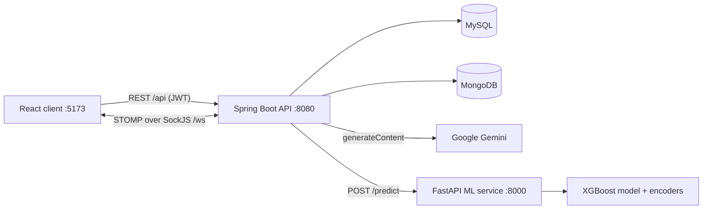
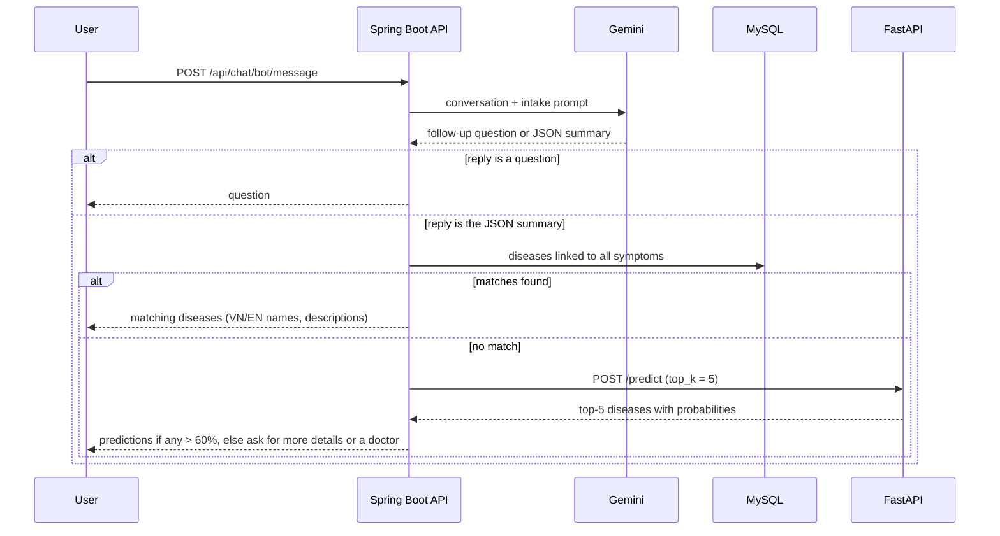

# Medical Diagnosis Chatbot (Capstone 2)

A chat-based assistant that collects a patient's symptoms in natural language, suggests likely diseases, and hands the case to a real doctor when the prediction is not confident. Team capstone project (March–June 2025) made of three services: a React client, a Spring Boot API, and a Python FastAPI machine-learning service.

> Academic prototype. The prediction model is trained on **synthetic** data and is not a medical device or a substitute for professional diagnosis.

## Overview

**Problem.** People with new symptoms often cannot tell how serious they are or which kind of doctor to see. Clinics would also like basic triage data (symptoms, risk factors, age, region, onset time) before a consultation.

**Approach.**
1. **Conversational intake.** A chat assistant powered by Google Gemini (1.5 Flash) asks follow-up questions in Vietnamese or English. Once it has enough information, it returns a structured JSON summary: age, gender, region, symptom start time, symptoms and risk factors.
2. **Knowledge-base lookup.** The API first searches its own disease–symptom database (MySQL) for diseases linked to *all* reported symptoms, matching by name or synonym.
3. **ML prediction.** If no disease matches, the API calls the FastAPI service. There, an **XGBoost** multi-class model returns the top 5 diseases with probabilities. A prediction counts as confident when any of them exceeds 60%. Otherwise the assistant asks for more details and suggests talking to a doctor.
4. **Doctor in the loop.** Patients can chat with doctors in real time. Escalated cases arrive as notifications. When a doctor confirms a diagnosis, the disease and its symptoms are written back into the knowledge base, so later lookups can match them.

## Key features

- **Authentication and roles.** JWT login, logout with token blacklisting, token introspection and refresh. BCrypt passwords. Roles `USER`, `DOCTOR`, `ADMIN`, `BOT` with method-level checks (`@PreAuthorize`).
- **Health-assistant chat.** Gemini-guided symptom collection. Conversations and messages are stored in MongoDB. Users can rename and delete conversations.
- **Disease lookup and prediction.** Database search by symptom names and synonyms, with a fallback to the XGBoost `/predict` endpoint (top-k with probability percentages).
- **Real-time chat with doctors.** STOMP over SockJS (`/ws`). Users pick a doctor and add them to a conversation.
- **Doctor workspace.**
  - Statistics dashboard (cases by season, region, gender and age group; word clouds).
  - Disease management (create, update, delete, search, paging).
  - Symptom browsing and search.
  - Review page for escalated cases, where the doctor confirms the diagnosis.
- **Doctor notifications.** Persisted notifications are also pushed over WebSocket (`/topic/doctor-notifications/{doctorId}`) and shown in a notification bell.
- **Admin page.** Create, list and delete doctor accounts. The admin statistics cards and the message panel currently show static placeholder data.
- **ML service.**
  - Synthetic data generator.
  - Preprocessing and training pipeline.
  - FastAPI endpoints: `/` (health), `/predict`, `/diseases_and_features`.

## Tech stack

| Layer | Technology |
|---|---|
| Client | React 19, TypeScript 5.7, Vite 6, Tailwind CSS 3, Redux Toolkit + redux-persist, React Router 7, Axios, STOMP.js + SockJS, Recharts, D3 + d3-cloud |
| API | Java 17, Spring Boot 3.4.2 (Web, Security + OAuth2 Resource Server, Data JPA, Data MongoDB, WebSocket, WebFlux `WebClient`), Nimbus JOSE JWT (HS256), MapStruct, Lombok, dotenv-java |
| Databases | MySQL 8 (users, roles, diseases, symptoms, patient cases, notifications), MongoDB (conversations, chat messages) |
| LLM | Google Gemini `gemini-1.5-flash` via the `generateContent` REST API |
| ML service | Python 3.11+, FastAPI, Uvicorn, XGBoost, scikit-learn, pandas, NumPy, joblib, mlxtend, Faker (data generation) |

## Architecture



How a chatbot message is handled (`ChatBotController` → `ChatServiceImpl.handleData`):



The Spring API calls the ML service at a fixed address, `http://127.0.0.1:8000` (`PredictionServiceImpl`). The request body uses the model's Vietnamese field names: `gioi_tinh` (gender), `do_tuoi` (age), `dia_diem` (location), `thoi_gian` (time), `trieu_chung` (symptoms), `yeu_to_nguy_co` (risk factors) and `top_k`.

## Machine-learning approach

**Data (synthetic).** `FastApi/generate_data.py` uses Faker (`vi_VN`) and a hand-written medical schema to create `model3/fake_health_data_50k.csv`, which is committed: 50,000 records covering **43 diseases** in 10 groups (respiratory, digestive, cardiovascular, infectious, endocrine, kidney/urinary, neurological, musculoskeletal, cancer, dermatology). Each record has:

- gender, and age drawn uniformly from 1–90;
- a province, weighted by northern, central or southern region;
- an onset date in 2023–2024, from which the season is derived;
- a disease sampled with weights = category prevalence × regional multiplier × seasonal multiplier;
- 1–4 symptoms and 1–3 risk factors sampled from that disease's lists.

**Cleaning and features.** `model3/processingDataModelXGB.py` does the following:

- Normalizes Vietnamese text: lower-casing, removing diacritics, and parsing stored list strings.
- Drops rows with missing essential fields or invalid dates.
- Extracts month, weekday and year from the onset date.
- Builds the feature set:
  - multi-hot encoded symptoms and risk factors (`MultiLabelBinarizer`);
  - gender, location, month and weekday as native XGBoost categorical columns;
  - age and year as numeric columns.
- Uses the disease (label-encoded) as the target.
- Splits the data 80/20, stratified by disease.

**Model.** The same script trains an `XGBClassifier` (`multi:softprob`, 1,000 trees, depth 6, learning rate 0.05, subsample and column sample 0.7). It saves the model and the encoders to `FastApi/model3/` as `.pkl` files, which `model3/main.py` loads at startup. `model3/trainXGB.py` is an alternative training script (500 trees, class-balanced sample weights) that writes a separately named model file.

**Earlier pipeline (association rules).** The first version of the service (`FastApi/predict2.py`, "model2") used an XGBoost model over one-hot English symptom names. It also used **Apriori association rules** (`association_rules.py`, mlxtend, minimum support 0.005, minimum confidence 0.5) to suggest related symptoms through `/suggest_symptoms`. The 93 mined rules are committed in `symptom_association_rules.csv`. The source dataset and the model2 encoders are not in the repository, and the current Spring API does not call this service.

## Project structure

```text
capstons2/
├── frontend/                  # React + TypeScript client (Vite)
│   └── src/
│       ├── features/
│       │   ├── auth/          # Login / register, token refresh
│       │   ├── chat/          # Conversations, health-assistant bot, doctor chat, WebSocket
│       │   ├── doctor/        # Dashboard charts, disease/symptom management, case review
│       │   ├── notifications/ # Notification bell (STOMP subscription)
│       │   ├── admin/         # Admin page (doctor accounts)
│       │   └── users/         # Profile
│       ├── routes/            # Route table and role-based ProtectedRoute
│       └── utils/apiClient.ts # Axios instance with JWT and 401 handling
├── backend/                   # Spring Boot API
│   └── src/main/java/com/prediction/backend/
│       ├── config/            # Security, JWT decoder, WebSocket, Gemini client, seed users
│       ├── controllers/       # REST and STOMP controllers
│       ├── services/impl/     # Auth, chat, chatbot, prediction client, search, statistics
│       ├── models/            # JPA entities (MySQL) and Mongo documents
│       └── repositories/
└── FastApi/                   # Python ML service
    ├── generate_data.py       # Synthetic dataset generator
    ├── model3/
    │   ├── processingDataModelXGB.py  # Preprocessing + training (writes model3/*.pkl)
    │   ├── trainXGB.py                # Alternative training script
    │   ├── main.py                    # FastAPI app used by the Spring API
    │   └── fake_health_data_50k.csv   # Committed synthetic dataset
    ├── predict2.py            # Earlier model2 API (association-rule suggestions)
    └── association_rules.py   # Apriori rule mining (earlier pipeline)
```

## Getting started

**Prerequisites:** Java 17 and Maven 3.6+, Node.js 18+ and npm, Python 3.11+, MySQL 8, MongoDB.

### 1. ML service (FastAPI, port 8000)

The trained model files are not stored in git. Build them once from the committed dataset:

```bash
cd FastApi
python3 -m venv .venv
source .venv/bin/activate
pip install -r requirements.txt

python model3/processingDataModelXGB.py               # writes model3/*.pkl (takes a while)
uvicorn model3.main:app --host 127.0.0.1 --port 8000  # GET / should report the model is loaded
```

Run both commands from the `FastApi/` folder, because the scripts use paths relative to it. To regenerate the dataset, run `pip install faker`, then `python generate_data.py`, then move the output into `model3/`.

### 2. API (Spring Boot, port 8080)

```bash
# MySQL database (tables are created by Hibernate, ddl-auto=update)
mysql -u root -p -e "CREATE DATABASE medical_diagnosis;"
# MongoDB must be running on localhost:27017 (database "sids")

cd backend
cp .env.example .env      # required: the app calls Dotenv.load() on startup
mvn spring-boot:run       # system Maven; the Maven wrapper config is not committed
```

On the first start, `ApplicationInitConfig` creates the roles and three accounts: `admin@gmail.com`, `doctor@gmail.com` and a bot user `bot@system.local`. Their initial passwords are defined in that class, so change them for any shared environment. The disease and symptom tables start empty. Add data through the doctor dashboard, or let doctors' confirmed diagnoses fill them.

### 3. Client (Vite, port 5173)

```bash
cd frontend
cp .env.example .env      # set VITE_BOT_ID to the id of the bot@system.local user
npm install
npm run dev               # http://localhost:5173
```

## Environment variables

**`backend/.env`** (see `backend/.env.example`). `BackendApplication` loads this file with dotenv-java and copies each entry into a JVM system property. Spring property names set here therefore override `application.properties`.

| Name | Required | Description |
|---|---|---|
| `spring.datasource.url` | Yes | MySQL JDBC URL (`jdbc:mysql://localhost:3306/medical_diagnosis`) |
| `spring.datasource.username` / `spring.datasource.password` | Yes | MySQL credentials |
| `spring.data.mongodb.uri` | Yes | MongoDB URI (`mongodb://localhost:27017/sids`) |
| `jwt.signerKey` | Yes | HS256 signing key (at least 32 random bytes) |
| `gemini.api.key` | Yes, for the chatbot | Google Gemini API key (`GEMINI_API_KEY` in the process environment also works) |
| `jwt.valid-duration` / `jwt.refreshable-duration` | No | Token lifetimes in seconds (defaults: 86400 / 604800) |

Secret values in `application.properties` are intentionally left empty; the backend expects them from `backend/.env`.

**`frontend/.env`** (see `frontend/.env.example`)

| Name | Required | Description |
|---|---|---|
| `VITE_BOT_ID` | Yes | User id of the `bot@system.local` account, used as the chatbot's participant id |
| `VITE_API_BASE_URL` | No | Leave unset for local development. REST then defaults to `http://localhost:8080/api` and WebSocket to `http://localhost:8080/ws`. |

## API reference

**Spring Boot** (port 8080). All routes require `Authorization: Bearer <JWT>` except where marked *Public*.

| Method | Path | Auth | Description |
|---|---|---|---|
| POST | `/api/auth/login` | Public | Log in, returns JWT |
| POST | `/api/auth/introspect`, `/api/auth/logout` | Public | Validate / invalidate a token |
| POST | `/api/auth/refresh-token` | JWT | Issue a new token |
| POST | `/api/users` | Public | Register a user |
| GET | `/api/users/me` | JWT | Current user |
| GET | `/api/users` | ADMIN | List users |
| GET | `/api/users/{id}`, `/api/users/email/{email}` | JWT | Get a user |
| PUT | `/api/users/{id}` | ADMIN or the user | Update a user |
| DELETE | `/api/users/{id}` | ADMIN | Delete a user |
| GET | `/api/users/doctors` | JWT | List doctors |
| POST | `/api/users/doctor` | ADMIN | Create a doctor account |
| POST | `/api/chat/start` | JWT | Start a conversation (with the bot or a doctor) |
| GET | `/api/chat/conversations?userId=`, `/api/chat/{id}/history` | JWT | Conversations and message history |
| PUT / DELETE | `/api/chat/conversation/{id}` | JWT | Rename / delete a conversation |
| POST | `/api/chat/conversation/{id}/add-user`, `/remove-user` | JWT | Add or remove a participant (e.g. a doctor) |
| POST | `/api/chat/bot/message?botId=` | JWT | Send a message to the health assistant |
| POST | `/api/search` | JWT | Diseases matching a list of symptom names |
| GET / POST / PUT / DELETE | `/api/diseases`, `/api/diseases/{id}` (+ `/paging`, `/search-paging`, `/search`, `/name-en/{name}`, `/name-vn/{name}`, `/severity/{s}`, `/specialization/{s}`) | JWT | Disease knowledge base |
| GET | `/api/symptoms` (+ `/{id}`, `/paging`, `/search-paging`, `/synonym/{kw}`, `/frequency/{f}`, `/name-en/{n}`, `/name-vn/{n}`) | JWT | Symptom lookup |
| GET / POST | `/api/disease-symptom/disease/{id}`, `/symptom/{id}`, `/symptoms` | JWT | Disease–symptom links |
| POST | `/api/diagnose?id_doctor=` | JWT | Send a patient case to a doctor (creates a notification) |
| GET | `/api/diagnose/{doctorId}` | JWT | Cases sent to a doctor |
| PUT | `/api/diagnose_disease` | JWT | Doctor confirms a diagnosis and updates the knowledge base |
| GET / PUT | `/api/patient-cases/by-notification/{id}`, `/api/patient-cases/{id}` | JWT | Read / update a case |
| GET / POST | `/api/notifications?userId=`, `/api/notifications/{id}`, `/api/notifications/read/{id}` | JWT | Doctor notifications |
| GET | `/api/stats/disease-by-season`, `/disease-by-location`, `/gender`, `/age-group`; `/api/chart-data` | JWT | Case statistics |
| POST / GET / DELETE | `/api/role`, `/api/permission` | JWT | Role and permission management |
| STOMP | send `/app/chat.send`; subscribe `/topic/conversations/{id}`, `/topic/doctor-notifications/{doctorId}` | Public (`/ws`) | Real-time chat and notifications |

**FastAPI ML service** (port 8000)

| Method | Path | Description |
|---|---|---|
| GET | `/` | Health check (503 if the model failed to load) |
| POST | `/predict` | Body: `gioi_tinh`, `do_tuoi`, `dia_diem`, `thoi_gian` (ISO 8601), `trieu_chung[]`, `yeu_to_nguy_co[]`, `top_k`. Returns `top_predictions` with probability percentages. |
| GET | `/diseases_and_features` | Known diseases, symptoms and risk factors |

## Known limitations

- **Escalation wiring.** On `main`, the chat UI's "call a doctor" prompt is commented out, so `POST /api/diagnose` is not called from the client yet. The `Dat` branch (three "Release 1.1" commits from June 2025, not merged into `main`) wires this flow.
- **Missing symptom write endpoints.** The client's symptom create, update and delete calls have no backend endpoint: `SymptomController` only exposes reads.
- **In-memory chatbot state.** Conversation state for the chatbot is kept in memory (`HashMap`), so it is lost on restart and not shared between instances. The WebSocket endpoint is not authenticated.
- **Synthetic model only.** The ML model is trained only on synthetic data. No evaluation results are committed. The ML service has no authentication and is meant to stay on localhost.
- **Admin placeholders.** The admin dashboard statistics and messages are placeholder data.
- **No automated tests** beyond the default Spring context test.

## Team

Team capstone project. Contributors as they appear in the commit history:

- **datngoca**: React client (chat, doctor dashboard, auth, admin, notifications), chat and chatbot integration, prediction client, statistics, releases
- **Hkhan2712**: real-time chat between users and doctors, chatbot and AI-model decision logic, disease search, saving doctor-confirmed diagnoses
- **Lê Văn Trung Tính** (tms-tinhle): project setup and the initial Spring Boot backend (JWT authentication and authorization, roles and permissions, user management, disease/symptom entities and CRUD), and the FastAPI ML service (synthetic data generator, preprocessing and XGBoost training pipeline, `/predict` API, earlier Apriori symptom-suggestion model)

## Author

Contributor: **Lê Văn Trung Tính** — Software Engineer | AI Product Builder

- Website: [trungtinh.site](https://trungtinh.site)
- GitHub: [@tinhne](https://github.com/tinhne)
